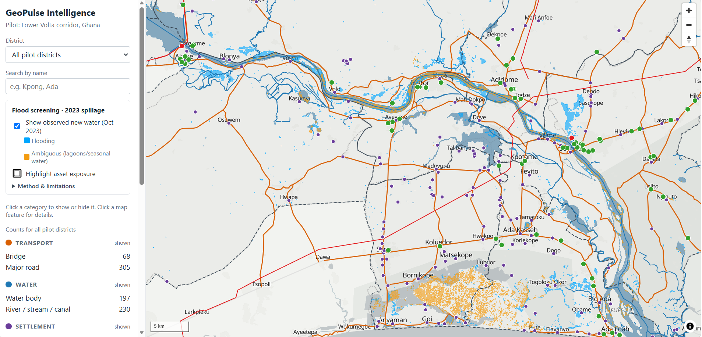

# GeoPulse Intelligence

**A geospatial decision-support platform for infrastructure, environmental and climate-risk screening.**
Pilot area: the **Lower Volta corridor, Ghana** (Akosombo to the Ada estuary), on an architecture designed to scale nationally.

> **Status: working prototype (local development).** This is a portfolio project. Outputs are *preliminary screening information*, not engineering certification, regulatory advice or an official flood map. See [Limitations](#limitations).



---

## What it does

GeoPulse brings asset locations, environmental hazard data, proximity analysis and source information together on one map, so that planners, engineers and environmental analysts can answer questions like:

- *Which roads, bridges, settlements and facilities lay in or near water observed during the 2023 Akosombo/Kpong dam spillage flooding?*
- *How does that change if "near" means 100 m, 250 m or 1 km?*
- *Where did each piece of information come from, how current is it, and what are its limits?*

### Implemented

| Module | What works now |
|---|---|
| **1. Infrastructure Asset Intelligence** | Interactive map of 1,296 assets (roads, bridges, waterways, water bodies, places, schools, health facilities, power infrastructure); category toggles; district filter; name search with zoom-to-result; popups with OpenStreetMap source links and snapshot dates |
| **2. Environmental Risk Screening** | Observed flood layer for October 2023, derived from Sentinel-1 radar; asset exposure screening (in flood / in ambiguous water / near / not flagged); method, dates and limitations shown in the interface |
| **3. Spatial Proximity** *(partial)* | User-selected screening distance (100 m – 1 km) using geodesic distances computed in PostGIS |
| **4. Dashboard** *(partial)* | Per-district asset counts and flood-screening summaries |

### Planned

| Module | Next steps |
|---|---|
| **3. Spatial Proximity** | General "what lies within X m of this asset/site" queries; road-network accessibility only if routable data proves reliable |
| **4. Dashboard** | Dedicated dashboard view with metric definitions |
| **5. Monitoring & Reporting** | CSV / GeoJSON / PDF screening reports including scope, sources, method and limitations |
| **6. Project & Site Comparison** | Side-by-side comparison of candidate sites on transparent, separately displayed criteria |

---

## Example result: 2023 flood screening

Using the observed flood layer and a 250 m "near" distance:

- Observed new water in the pilot is reported as a **range of ~38–78 km²**. The lower bound counts only flooding attributable to the event. The upper bound adds new water in places that historically hold water seasonally (e.g. the Songor lagoon and salt pans), which cannot be confidently attributed to the spillage.
- **22 named settlements**, **2 hospitals** and **5 education facilities** lie within 250 m of observed new water. **56 major road segments** are near it, and 2 lie partly inside it.
- No settlement point lies *inside* observed flooding. This reflects two known limits: settlements are mapped as single points, and radar under-detects water among buildings. It is **not** evidence that settlements stayed dry.

These figures are preliminary screening outputs and have not been validated against field data.

---

## Architecture

```
Source data ──► Python processing & validation ──► PostgreSQL + PostGIS ──► FastAPI ──► React + MapLibre
(HDX, OSM,       (geopandas, pyogrio, rasterio,     (spatial tables,          (GeoJSON     (map, filters,
 Sentinel-1       Google Earth Engine)                indexes, screening)       endpoints)   screening panel)
 via Earth Engine)
```

| Layer | Technology |
|---|---|
| Frontend | React + TypeScript (Vite), MapLibre GL JS, OpenFreeMap basemap |
| API | Python, FastAPI, SQLAlchemy |
| Spatial database | PostgreSQL 17 + PostGIS 3.6 |
| Data processing | geopandas, pyogrio, rasterio, Google Earth Engine Python API |
| Environment | conda (conda-forge), npm |
| Version control | Git + GitHub |

**Design principles:**
- **The pilot is data, not code.** The pilot area is a list of official district P-codes in `config/pilot_lower_volta.json`. All 260 districts of Ghana are loaded, so extending coverage is a configuration change.
- **Traceability.** Every asset stores its source dataset, its exact OpenStreetMap object reference and its snapshot date. The flood layer stores its full method metadata: parameters, dates and Sentinel-1 scene IDs.
- **Uncertainty is visible.** Coverage warnings, the "ambiguous water" class and the limitations panel are stored as data and shown in the interface.
- **Distances are geodesic.** Data is stored in EPSG:4326, and distances and areas use PostGIS `geography`. The pilot straddles UTM zones 30N/31N, so a single UTM zone would not scale nationally.

### Database tables

| Table | Contents |
|---|---|
| `admin_boundaries` | All 260 Ghana districts (COD-AB) with P-codes |
| `pilot_districts` | Which districts belong to which pilot |
| `assets` | Unified asset table with source, reference, snapshot date and district |
| `asset_types` | Asset type, category, display label and coverage warning |
| `hazard_layers` | Hazard layer metadata (method, dates, parameters, limitations) |
| `hazard_features` | Hazard polygons by class |
| `asset_hazard_screening` | Per-asset distances to hazard classes and flooded length |

### API endpoints

| Endpoint | Returns |
|---|---|
| `GET /health` | API and database status |
| `GET /asset-types` | Asset types with counts and coverage warnings |
| `GET /assets?asset_type=&pcode=&limit=` | Assets as GeoJSON |
| `GET /pilots/{pilot_id}/districts` | Pilot districts as GeoJSON with bounding box |
| `GET /hazards` | Hazard layers with method, dates and limitations |
| `GET /hazards/{hazard_id}/features` | Hazard polygons as GeoJSON |
| `GET /screening/{hazard_id}?near_m=` | Exposure status of every asset, plus a summary |

Interactive API documentation is available at `http://127.0.0.1:8000/docs` when the API is running.

---

## Data sources

| ID | Dataset | Provider | Licence | Use |
|---|---|---|---|---|
| D-01 | Ghana Subnational Administrative Boundaries (COD-AB) | Ghana Statistical Service via OCHA HDX | CC BY-IGO 3.0 | Districts, P-codes, pilot extent |
| D-02 | OpenStreetMap Ghana extract (snapshot 2026-10-31) | OpenStreetMap contributors via Geofabrik | ODbL 1.0 | Assets |
| D-05 | Copernicus DEM GLO-30 (2024_1) | ESA / Copernicus | Copernicus DEM licence | Slope mask |
| D-07 | Sentinel-1 GRD | ESA / Copernicus | Copernicus open data | Flood mapping input |
| D-08 | Observed flood extent, Oct 2023 | Derived in this project from D-07 | Derived | Hazard layer |
| — | JRC Global Surface Water 1.4 | European Commission JRC | See provider terms | Permanent / recurrent water masks |
| — | Basemap | OpenFreeMap (OpenStreetMap data) | See provider terms | Background map |

Full metadata, coverage findings and known limitations for each dataset are in [`docs/data-inventory.md`](docs/data-inventory.md).

**Attribution:** © OpenStreetMap contributors. Contains modified Copernicus Sentinel data (2023). Boundaries: Ghana Statistical Service via OCHA HDX.

---

## Flood mapping method (summary)

Sentinel-1 VV radar change detection in Google Earth Engine, adapted from UN-SPIDER's Recommended Practice:

1. For each of two ascending orbit tracks (relative orbits 147 and 74): compare a single flood-date image (16 and 23 Oct 2023 respectively) with the **median of five pre-event scenes** (19 Jul – 10 Sep 2023, before the controlled spillage began on 15 Sep 2023).
2. Flag pixels with strong darkening (ratio > 1.25) that are also dark in the flood image (< −15 dB).
3. Remove permanent water (JRC GSW), slopes > 5°, and clusters smaller than 8 pixels.
4. Classify new water in places that historically hold water ≥10% of the time as **ambiguous**, rather than counting it as event flooding.
5. Combine both tracks, which together give 100% coverage of the pilot.

All parameters and scene IDs are recorded in the output metadata file. Thresholds are standard starting values and have not been validated against field data.

---

## Limitations

- **The flood layer shows water observed on two dates**, not peak extent and not a single moment in time.
- **Radar under-detects flooding** under dense vegetation and among buildings, so the flood extent is likely an **under-estimate**.
- **OpenStreetMap coverage is uneven.** Health facilities and power infrastructure are sparsely mapped in the pilot, and the interface warns about this. **Absence of a feature on the map is not absence on the ground.**
- **Source tagging errors exist.** For example, Kpong Generating Station is tagged in OSM as a substation. Source data is kept as published, with its reference, rather than silently corrected.
- **Settlements are single points.** Screening uses distance to a village centre, not its footprint. Settlement extents are planned.
- **Screening flags proximity, not damage.** Assets that are not flagged are not confirmed safe.

---

## Running it locally

### Prerequisites
- PostgreSQL 17 with PostGIS 3.6
- [Miniforge](https://github.com/conda-forge/miniforge) (conda with conda-forge)
- Node.js 24 and npm
- Git
- A Google Earth Engine cloud project registered for non-commercial use (needed only for the flood-mapping step)

### 1. Clone and set up the Python environment
```bash
git clone https://github.com/Abdul-Sobbur/geopulse-intelligence.git
cd geopulse-intelligence
conda env create -f environment.yml
conda activate geopulse
```

### 2. Configure settings
Copy `.env.example` to `.env` and fill in your values. `.env` is ignored by Git and never committed.
```
DB_HOST=localhost
DB_PORT=5432
DB_NAME=geopulse
DB_USER=postgres
DB_PASSWORD=change_me
GEE_PROJECT=your-earth-engine-project-id
```

### 3. Create the database
```bash
psql -U postgres -c "CREATE DATABASE geopulse;"
psql -U postgres -d geopulse -c "CREATE EXTENSION postgis;"
```

### 4. Download source data (not included in the repository)
- **Boundaries:** download the shapefile zip from the HDX dataset *Ghana – Subnational Administrative Boundaries* and extract it into `data/raw/boundaries/`.
- **OpenStreetMap:** download a Ghana `.osm.pbf` extract from Geofabrik into `data/raw/osm/`, then set its path and snapshot date in `config/pilot_lower_volta.json`.

### 5. Run the data pipeline (from the project root)
```bash
python scripts/load_admin_boundaries.py     # districts + pilot definition
python scripts/load_osm_assets.py           # OSM assets
earthengine authenticate                    # one-time
python scripts/s1_flood_extent.py           # flood layer (Earth Engine)
python scripts/load_flood_layer.py          # flood polygons into PostGIS
python scripts/screen_flood_exposure.py     # asset exposure screening
```
Optional inspection scripts: `inspect_boundaries.py`, `inspect_osm.py`, `s1_scene_inventory.py`.

### 6. Start the API
```bash
cd backend
uvicorn app.main:app --reload
```

### 7. Start the frontend (in a second terminal)
```bash
cd frontend
npm install
npm run dev
```
Open `http://localhost:5173`.

---

## Project structure

```
geopulse-intelligence/
├── backend/app/          FastAPI application (main.py, db.py)
├── frontend/             React + TypeScript + MapLibre app (Vite)
├── scripts/              Data loading, inspection, flood mapping and screening
├── config/               Pilot definition and data source settings
├── docs/                 Data inventory and documentation
├── data/                 Raw and processed data (ignored by Git)
├── environment.yml       Python environment
└── .env.example          Settings template
```

---

## Roadmap

- [x] Module 1: asset map, search, filters, provenance
- [x] Module 2: observed flood layer and exposure screening
- [ ] Settlement footprints (GRID3) to improve settlement screening
- [ ] Module 3: general proximity queries
- [ ] Module 4: dashboard view with metric definitions
- [ ] Module 5: CSV / GeoJSON / PDF screening reports
- [ ] Module 6: candidate site comparison
- [ ] Docker Compose, automated checks (GitHub Actions), deployment

---

## Licence

Code: MIT (see `LICENSE`). Data remains under the licences of its original providers (see [Data sources](#data-sources)). Derived OpenStreetMap data is subject to the ODbL.

## Author

**Abdul-Sobbur**: civil engineering, GIS and remote sensing.
